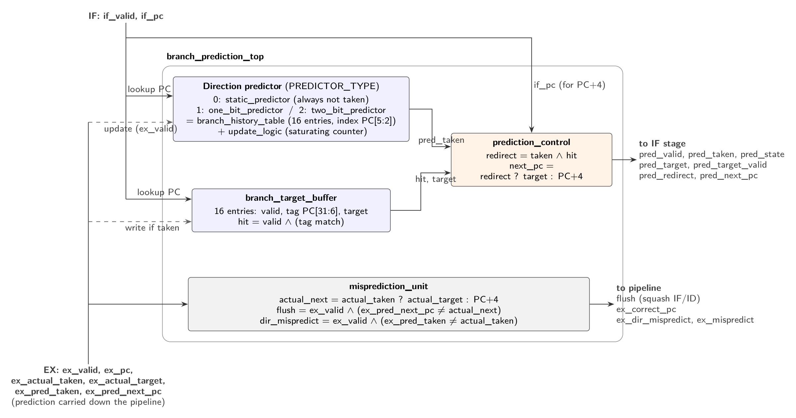
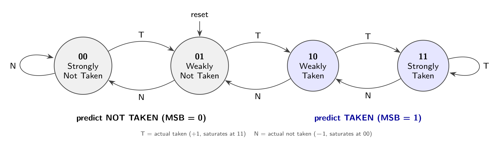
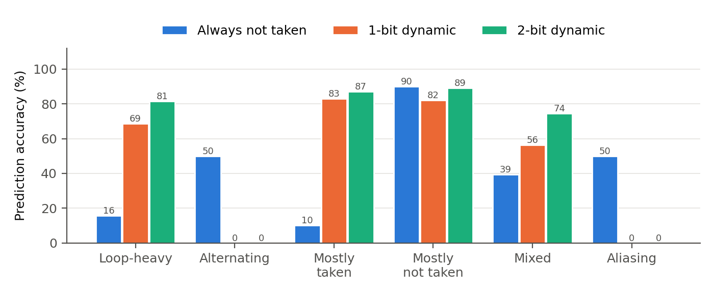

# Design and Verification of a Dynamic Branch Prediction Unit Using 1-Bit and 2-Bit Saturating Predictors

**DBPU (Dynamic Branch Prediction Unit)** | Modern Computer Architecture, Project 5 | Phase I

A modular, synthesizable Verilog implementation of a branch prediction unit with a static
always-not-taken baseline, a dynamic 1-bit predictor and a dynamic 2-bit saturating-counter
predictor, a Branch History Table, a Branch Target Buffer and a pipeline flush interface,
verified with self-checking testbenches and evaluated on identical branch traces.

| | |
|---|---|
| IEEE report (PDF) | [`reports/IEEE_Project_Report.pdf`](reports/IEEE_Project_Report.pdf) (source: [`.tex`](reports/IEEE_Project_Report.tex)) |
| Prototype video | **[VIDEO LINK: to be added after upload]** |
| Results | [`analysis/results/summary.md`](analysis/results/summary.md) |
| Phase I checklist | [`PHASE1_SUBMISSION_CHECKLIST.md`](PHASE1_SUBMISSION_CHECKLIST.md) |

> Scope: this is a **standalone prediction unit** with a pipeline-style interface. It is not a
> complete processor; the testbenches act as the IF and EX stages of a hypothetical 5-stage
> pipeline. Results are from RTL simulation and Yosys synthesis; nothing has been run on FPGA
> hardware.

---

## 1. Problem statement

In a pipelined processor a conditional branch (`BEQ`, `BNE`) is resolved only in the EX stage,
but the fetch stage needs the next address immediately. This is a **control hazard**. If fetch
guesses wrongly, the wrong-path instructions must be flushed and those cycles are lost (the
**misprediction penalty**). A branch predictor guesses the outcome in hardware so that most
branches cost no stall.

## 2. Objectives

From the official project specification (`Project_list_MCA.pdf`, Project 5):

1. Implement an always-not-taken baseline. ✔
2. Add a 1-bit predictor. ✔
3. Extend it to a 2-bit saturating predictor. ✔
4. Feed branch traces to the predictors. ✔
5. Calculate prediction accuracy. ✔
6. Estimate CPI impact. ✔
7. Compare the prediction strategies. ✔

## 3. Features

**Official requirements**
* Static always-not-taken predictor (baseline)
* Dynamic 1-bit predictor and 2-bit saturating-counter predictor (states 00/01/10/11, no wrap-around)
* Parameterized Branch History Table (entries, state width, reset value)
* Prediction logic and update logic
* Branch Target Buffer (valid, tag, target)
* Pipeline flush / control interface (misprediction detection, flush, corrected next PC)
* Loop-oriented BEQ/BNE branch traces, accuracy tables, waveforms, strategy comparison

**Additional work (beyond the specification)**
* Pipelined integration testbench (IF lookup, EX resolution 2 cycles later, squash + refetch)
  checked against a reference model every cycle
* Row-by-row cross-check of all RTL trace results against an independent Python model
* Mutation testing (7 injected bugs, all detected)
* BHT-size sweep (2 to 64 entries) re-simulating the RTL for each size
* Yosys synthesis with latch check and Xilinx 7-series cell counts

## 4. Technical stack

| Purpose | Tool (version used) |
|---|---|
| HDL | Verilog-2005 |
| Simulation | Icarus Verilog 13.0 |
| Waveforms | VCD files; GTKWave (optional) or `scripts/vcd_to_png.py` |
| Synthesis | Yosys 0.71 |
| Analysis / plots | Python 3 + Matplotlib |
| Report | LaTeX (IEEEtran), built with Tectonic |
| Version control | Git / GitHub |

## 5. System architecture



| Module | Role |
|---|---|
| `branch_prediction_top` | Selects predictor via `PREDICTOR_TYPE` (0 static, 1 one-bit, 2 two-bit); integrates everything |
| `static_predictor` | Always predicts not taken |
| `one_bit_predictor` / `two_bit_predictor` | BHT + update logic |
| `branch_history_table` | Untagged table, index `PC[5:2]` (16 entries), 2 read ports + 1 write port |
| `update_logic` | N-bit saturating counter (1-bit = last outcome) |
| `branch_target_buffer` | Direct-mapped, tagged; written on taken branches |
| `prediction_control` | IF: `pred_next_pc = (taken && btb_hit) ? target : PC+4` |
| `misprediction_unit` | EX: `flush = pred_next_pc != actual_next_pc`, provides `ex_correct_pc` |

Full details, interface table and all nine diagrams: [`docs/ARCHITECTURE.md`](docs/ARCHITECTURE.md).

## 6. How the predictors work

**Static (always not taken):** fetch always continues at PC + 4. No storage, no learning.

**1-bit:** each BHT entry remembers the last outcome. A loop `T T T T T N` is mispredicted
twice per loop execution: at the exit, and again on the next loop entry.

**2-bit saturating counter:**



Taken: `00->01->10->11->11`. Not taken: `11->10->01->00->00`. Predict taken when the MSB is 1.
One unusual outcome (e.g. a loop exit) moves `11` only to `10`, which still predicts taken, so
the 2-bit predictor misses only once per loop execution.

## 7. Repository structure

```
rtl/            9 synthesizable Verilog modules
testbench/      7 self-checking testbenches + tb_trace_runner (trace evaluation)
simulation/     run_tests.sh, run_sim.sh, GTKWave save files (VCDs generated here)
traces/         generate_traces.py + 6 branch traces (CSV)
analysis/       performance_analysis.py, results/ (CSV, JSON, Markdown), plots/
synthesis/      run_synth.sh, summarize.py, SYNTHESIS_RESULTS.md, reports/*_stat.txt
scripts/        vcd_to_png.py (waveform figures), mutation_test.sh
docs/           ARCHITECTURE, TESTING, REFERENCES, CONTRIBUTIONS, PROJECT_STATUS,
                diagrams/, waveforms/
reports/        IEEE_Project_Report.tex / .pdf
demo/           5-minute video script, recording checklist, visual assets
```

## 8. Installation

macOS (Homebrew):
```bash
brew install icarus-verilog yosys
brew install --cask gtkwave          # optional waveform viewer
python3 -m pip install -r requirements.txt
```
Ubuntu/Debian:
```bash
sudo apt install iverilog yosys gtkwave python3-pip
python3 -m pip install -r requirements.txt
```
Optional, to rebuild the PDF report: `brew install tectonic` (or any LaTeX distribution with
IEEEtran).

## 9. Running simulations and tests

```bash
make test                              # compile + run all 7 self-checking testbenches
make sim  TB=tb_two_bit_predictor      # run one testbench (log printed to the terminal)
make wave TB=tb_two_bit_predictor      # run it and open GTKWave
bash scripts/mutation_test.sh          # check that the tests catch injected bugs
```

Expected `make test` output (actual run):
```
tb_static_predictor          PASS   83/83 checks passed
tb_one_bit_predictor         PASS   49/49 checks passed
tb_two_bit_predictor         PASS   69/69 checks passed
tb_branch_history_table      PASS   33/33 checks passed
tb_branch_target_buffer      PASS   20/20 checks passed
tb_misprediction             PASS   12/12 checks passed
tb_branch_prediction_top     PASS   3013/3013 checks passed
Summary: 7 passed, 0 failed
```
What each test checks: [`docs/TESTING.md`](docs/TESTING.md).

## 10. Waveforms

Every testbench writes a VCD file to `simulation/waveforms/`. Open one in GTKWave:
```bash
gtkwave simulation/waveforms/tb_two_bit_predictor.vcd simulation/waveforms/tb_two_bit_predictor.gtkw
```
`make waves` renders PNG figures from the VCD files into `docs/waveforms/`, for example:


How to read each figure: [`docs/TESTING.md` section 6](docs/TESTING.md#6-waveform-evidence-and-how-to-read-it).

## 11. Performance evaluation

```bash
make traces     # regenerate the 6 traces (deterministic, seeded)
make results    # trace sims + BHT sweep + pipelined runs + analysis + plots
```
The same trace is fed to all three predictors. CPI model (assumptions, configurable):
`CPI = 1.0 + 0.20 x misprediction_rate x 2 cycles` (base CPI 1.0, 20 % branches, 2-cycle
penalty because the branch is resolved in EX).

## 12. Results (actual RTL simulation, 16-entry BHT)

| Workload | Branches | Static acc. | 1-bit acc. | 2-bit acc. | Static CPI | 1-bit CPI | 2-bit CPI |
|---|---:|---:|---:|---:|---:|---:|---:|
| Loop-heavy | 70 | 15.71 % | 68.57 % | **81.43 %** | 1.337 | 1.126 | **1.074** |
| Alternating | 60 | **50.00 %** | 0.00 % | 0.00 % | **1.200** | 1.400 | 1.400 |
| Mostly taken | 100 | 10.00 % | 83.00 % | **87.00 %** | 1.360 | 1.068 | **1.052** |
| Mostly not taken | 100 | **90.00 %** | 82.00 % | 89.00 % | **1.040** | 1.072 | 1.044 |
| Mixed | 160 | 39.38 % | 56.25 % | **74.38 %** | 1.242 | 1.175 | **1.103** |
| Aliasing | 80 | **50.00 %** | 0.00 % | 0.00 % | **1.200** | 1.400 | 1.400 |



Key observations:
* Loops: 1-bit misses 2 per loop execution, 2-bit only 1 (22 vs 13 mispredictions on the loop trace).
* Biased branches: 2-bit tolerates rare opposite outcomes; 1-bit pays twice for each.
* Alternating and aliased patterns defeat both local counter predictors (0 %); static gets 50 %.
* Enlarging the BHT from 16 to 32 entries removes the aliasing (0 % -> 98.75 %), see
  `analysis/plots/bht_size_sweep.png`.

Synthesis (Yosys, Xilinx 7-series mapping, pre-place-and-route estimate, no Fmax):

| Configuration | LUTs | Flip-flops |
|---|---:|---:|
| Static + BTB | 510 | 944 |
| 1-bit BHT + BTB | 602 | 960 |
| 2-bit BHT + BTB | 634 | 976 |

No latches inferred. Run `make synth`. Details: [`synthesis/SYNTHESIS_RESULTS.md`](synthesis/SYNTHESIS_RESULTS.md).

## 13. Team

| Member | Responsibility |
|---|---|
| Aaryan Krishna | Coordination, architecture, integration, final validation |
| Pratik Agade | Static and 1-bit predictors, BTB |
| Raghvendra Singh | 2-bit predictor, Branch History Table, update logic |
| Vedant Satbhai | Testbenches and waveform verification |
| Vivek Kumar Raj | Traces, performance analysis, documentation and report |

Contribution status and AI-assistance disclosure: [`docs/CONTRIBUTIONS.md`](docs/CONTRIBUTIONS.md).
How to contribute: [`CONTRIBUTING.md`](CONTRIBUTING.md).

## 14. References

Key sources: J. E. Smith, ISCA 1981 [1]; Lee and Smith, IEEE Computer 1984 [2];
Hennessy and Patterson, *Computer Architecture: A Quantitative Approach* [10].
Full verified list: [`docs/REFERENCES.md`](docs/REFERENCES.md).

## 15. Limitations and future enhancements

Limitations: standalone unit (no processor), synthetic traces, conditional direct branches
only, no Fmax/FPGA results.

Phase II ideas: integrate into a 5-stage RV32I pipeline and measure real CPI; traces from
compiled benchmarks; gshare / tournament predictors; return-address stack; place-and-route
timing on an FPGA board.

## License

MIT, see [`LICENSE`](LICENSE).
