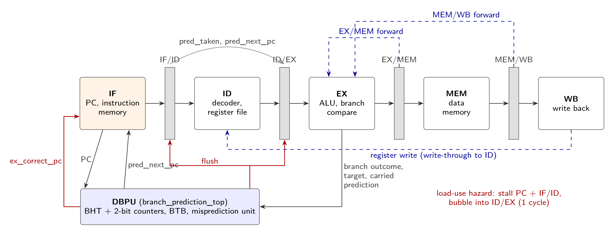
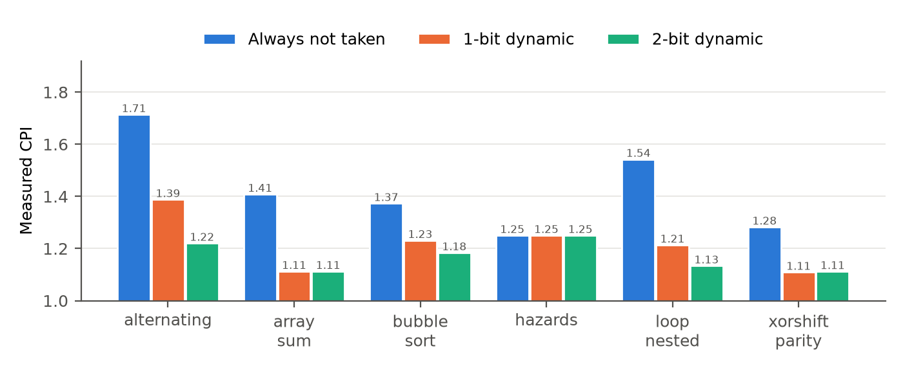
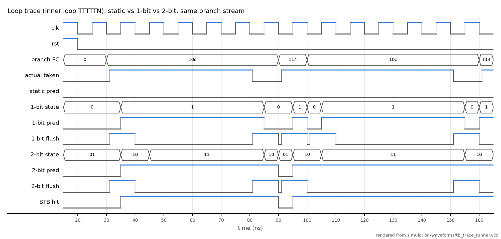

# Dynamic Branch Prediction Unit

**Design and Verification of a Dynamic Branch Prediction Unit Using 1-Bit and 2-Bit Saturating Predictors**
Modern Computer Architecture, Project 5

A synthesizable Verilog branch prediction unit with a static always-not-taken baseline, a dynamic
1-bit predictor and a dynamic 2-bit saturating-counter predictor, a Branch History Table, a Branch
Target Buffer and a pipeline flush interface. The three predictors are verified with
self-checking testbenches and compared on identical branch traces.

IEEE report: [`reports/IEEE_Project_Report.pdf`](reports/IEEE_Project_Report.pdf)  
Demo video: [Google Drive folder](https://drive.google.com/drive/folders/12UvALPxddAPNzJRCkyqhxD6rn5Etck1M)

## Overview

In a pipelined processor a conditional branch (`BEQ`, `BNE`) is resolved only in the EX stage,
while the fetch stage needs the next address immediately. This **control hazard** forces the
processor to guess; a wrong guess flushes the wrong-path instructions and costs cycles (the
**misprediction penalty**). The DBPU makes that guess in hardware at fetch time, learns from
each resolved branch, and raises a flush with the correct next PC when a guess was wrong.

The unit has a pipeline-style interface (IF lookup, EX resolution) and is integrated into the
fetch stage of a **five-stage RV32I pipeline** that runs assembled programs, so the effect of
each predictor on CPI is measured, not only estimated.

## Features

* Static always-not-taken predictor (baseline)
* Dynamic 1-bit predictor and 2-bit saturating-counter predictor (00/01/10/11, no wrap-around)
* Parameterized, untagged Branch History Table (entries, state width, reset value)
* Direct-mapped, tagged Branch Target Buffer (valid, tag, target)
* Next-PC prediction, misprediction detection, pipeline flush and corrected PC
* Nine self-checking testbenches, including a pipelined integration testbench, a processor
  system test and a
  parameter-sweep testbench (table sizes 1-32, 16/32/64-bit PCs)
* Six loop-oriented BEQ/BNE branch traces; accuracy, misprediction rate and estimated CPI
* RTL results cross-checked against an independent Python reference model
* Five-stage RV32I pipeline (forwarding, load-use stall, branches resolved in EX) with the
  DBPU in the fetch stage and hardware performance counters
* Assembler and reference instruction-set simulator; every program run is checked against it
* Mutation testing, BHT-size sweep and Yosys synthesis

## Architecture


| Module | Role |
|---|---|
| `branch_prediction_top` | Selects the predictor via `PREDICTOR_TYPE` (0 static, 1 one-bit, 2 two-bit) and integrates all blocks |
| `static_predictor` | Always predicts not taken |
| `one_bit_predictor` / `two_bit_predictor` | Branch History Table + update logic |
| `branch_history_table` | Untagged table, index `PC[5:2]` (16 entries), 2 read ports + 1 write port |
| `update_logic` | N-bit saturating counter (1-bit = last outcome) |
| `branch_target_buffer` | Direct-mapped, tagged; written by taken branches |
| `prediction_control` | IF: `pred_next_pc = (taken && btb_hit) ? target : PC + 4` |
| `misprediction_unit` | EX: `flush = (pred_next_pc != actual_next_pc)`, provides `ex_correct_pc` |

Interface, design decisions and all diagrams: [`docs/ARCHITECTURE.md`](docs/ARCHITECTURE.md).

### Processor integration



`rv32_pipeline_core` is a classic IF/ID/EX/MEM/WB pipeline for the RV32I subset ADD, SUB, AND,
OR, XOR, SLT, SLL, SRL (and immediate forms), LW, SW, BEQ, BNE and ECALL (halt). The PC is looked
up in the DBPU every cycle; branches resolve in EX, and a misprediction flushes IF/ID and ID/EX
(2-cycle penalty). Results are forwarded from EX/MEM and MEM/WB, and a load followed by a
dependent instruction stalls for one cycle. Performance counters record cycles, retired
instructions, branches, flushes, direction mispredictions and stalls, with
`cycles = instret + 4 + 2 x flushes + stalls`.

| Module | Role |
|---|---|
| `rv32_pipeline_core` | Pipeline, hazard handling, DBPU connection, performance counters |
| `rv32_decoder` | Instruction decode and control |
| `rv32_alu` | ALU (add, sub, and, or, xor, slt, sll, srl) |
| `rv32_regfile` | 32 x 32 register file with write-through |
| `rv32_imem` / `rv32_dmem` | 1 KiB instruction and data memories |

## How the predictors work

* **Static:** fetch always continues at PC + 4; no storage, no learning.
* **1-bit:** each BHT entry stores the last outcome. A loop `T T T T T N` is mispredicted twice
  per execution: at the exit and again at the next loop entry.
* **2-bit saturating counter:** taken `00->01->10->11->11`, not taken `11->10->01->00->00`;
  predict taken when the MSB is 1. A single loop exit moves `11` only to `10`, which still
  predicts taken, so the loop is mispredicted only once per execution.


## Results

Same trace fed to all three predictors, 16-entry BHT (RTL simulation). Estimated
`CPI = 1.0 + 0.20 x misprediction rate x 2` (base CPI 1.0, 20 % branches, 2-cycle penalty).

| Workload | Branches | Static acc. | 1-bit acc. | 2-bit acc. | Static CPI | 1-bit CPI | 2-bit CPI |
|---|---:|---:|---:|---:|---:|---:|---:|
| Loop-heavy | 70 | 15.71 % | 68.57 % | **81.43 %** | 1.337 | 1.126 | **1.074** |
| Alternating | 60 | **50.00 %** | 0.00 % | 0.00 % | **1.200** | 1.400 | 1.400 |
| Mostly taken | 100 | 10.00 % | 83.00 % | **87.00 %** | 1.360 | 1.068 | **1.052** |
| Mostly not taken | 100 | **90.00 %** | 82.00 % | 89.00 % | **1.040** | 1.072 | 1.044 |
| Mixed | 160 | 39.38 % | 56.25 % | **74.38 %** | 1.242 | 1.175 | **1.103** |
| Aliasing | 80 | **50.00 %** | 0.00 % | 0.00 % | **1.200** | 1.400 | 1.400 |


* Loops: 22 mispredictions with the 1-bit predictor, 13 with the 2-bit predictor.
* Biased branches: the 2-bit counter tolerates rare opposite outcomes; the 1-bit predictor pays
  twice for each.
* Alternating and aliased branches defeat both local counter predictors; enlarging the BHT
  from 16 to 32 entries removes the aliasing (0 % -> 98.75 %), see
  [`analysis/plots/bht_size_sweep.png`](analysis/plots/bht_size_sweep.png).

Full tables (including BHT sweep and pipelined cycle counts):
[`analysis/results/summary.md`](analysis/results/summary.md).

### Measured CPI on the RV32I pipeline

Hardware performance counters of the simulated CPU; every run checked against the reference ISS.

| Program | Instr. | Static CPI | 1-bit CPI | 2-bit CPI |
|---|---:|---:|---:|---:|
| loop_nested | 225 | 1.542 | 1.213 | **1.133** |
| array_sum | 392 | 1.408 | **1.112** | **1.112** |
| bubble_sort | 550 | 1.373 | 1.231 | **1.184** |
| xorshift_parity | 680 | 1.282 | **1.109** | 1.112 |
| alternating | 227 | 1.714 | 1.388 | **1.220** |
| hazards | 36 | 1.250 | 1.250 | 1.250 |
| **All programs** | 2110 | 1.403 | 1.185 | **1.147** |

The 2-bit predictor gives a 1.22x speed-up over the static baseline across all programs.
Full table: [`analysis/results/cpu_summary.md`](analysis/results/cpu_summary.md).



**Synthesis** (Yosys, Xilinx 7-series mapping, pre-place-and-route; no latches inferred):

| Configuration | LUTs | Flip-flops | Block RAM |
|---|---:|---:|---:|
| Static + BTB | 510 | 944 | 0 |
| 1-bit BHT + BTB | 602 | 960 | 0 |
| 2-bit BHT + BTB | 634 | 976 | 0 |
| RV32I CPU + 2-bit DBPU | 2352 | 2619 | 2 x RAMB18 |

Details: [`synthesis/SYNTHESIS_RESULTS.md`](synthesis/SYNTHESIS_RESULTS.md).

## Verification

```
tb_static_predictor          PASS   83/83 checks passed
tb_one_bit_predictor         PASS   49/49 checks passed
tb_two_bit_predictor         PASS   70/70 checks passed
tb_branch_history_table      PASS   33/33 checks passed
tb_branch_target_buffer      PASS   22/22 checks passed
tb_misprediction             PASS   12/12 checks passed
tb_branch_prediction_top     PASS   3013/3013 checks passed
tb_parameter_validation      PASS   35/35 checks passed
tb_rv32_pipeline             PASS   5202/5202 checks passed
Summary: 9 passed, 0 failed
```

* The integration testbench runs all three predictors with five-stage timing (lookup in IF,
  resolution in EX two cycles later, squash and refetch on flush) and compares every output
  with a reference model, on directed stimulus and on all six traces.
* Every prediction in the trace simulations matches an independent Python model (0 mismatches).
* The processor test runs every program on three CPUs (static, 1-bit, 2-bit) and checks all
  registers, data memory, instruction count and the cycle accounting against the ISS.
* Mutation testing: 12 of 12 deliberately injected bugs are detected (7 in the predictor,
  5 in the processor).

Test descriptions and waveform figures: [`docs/TESTING.md`](docs/TESTING.md).



## Getting started

**Requirements:** Icarus Verilog, Python 3 with Matplotlib; optional: Yosys (synthesis),
GTKWave (waveforms), Tectonic or a LaTeX distribution (report).

```bash
# macOS
brew install icarus-verilog yosys
brew install --cask gtkwave
# Ubuntu / Debian
sudo apt install iverilog yosys gtkwave

python3 -m pip install -r requirements.txt
```

**Commands** (run from the repository root):

```bash
make test                            # run all self-checking testbenches
make sim  TB=tb_two_bit_predictor    # run one testbench
make wave TB=tb_two_bit_predictor    # run one testbench and open GTKWave
make traces                          # regenerate the branch traces (deterministic)
make programs                        # assemble programs/*.s, compute reference results (ISS)
make cpu                             # run all programs on the RV32I CPU, CPI table and plot
make results                         # trace simulations, BHT sweep, pipelined runs, analysis, plots
make waves                           # render waveform figures from the VCD files
make synth                           # Yosys synthesis of all three configurations
make report                          # build the IEEE report PDF
bash scripts/mutation_test.sh        # mutation testing
```

## Repository structure

```
rtl/          Verilog RTL: predictor (9 modules) and RV32I pipeline (rv32_*.v)
programs/     RV32I assembly programs (built into programs/build/ by make programs)
testbench/    self-checking testbenches and the trace runner
simulation/   test scripts and GTKWave save files (VCDs are generated here)
traces/       trace generator and six branch traces (CSV)
analysis/     performance analysis script, results and plots
synthesis/    Yosys flow, summary and raw statistics
scripts/      RV32I assembler + ISS, program builder, waveform renderer, mutation testing
docs/         architecture, testing, references, contributions, diagrams, waveforms
reports/      IEEE report (LaTeX source and PDF)
```

## Team

| Member | Area |
|---|---|
| Aaryan Krishna | Coordination, architecture, integration, final validation |
| Pratik Agade | Static and 1-bit predictors, Branch Target Buffer |
| Raghvendra Singh | 2-bit predictor, Branch History Table, update logic |
| Vedant Satbhai | Testbenches and waveform verification |
| Vivek Kumar Raj | Traces, performance analysis, documentation and report |

Contribution record: [`docs/CONTRIBUTIONS.md`](docs/CONTRIBUTIONS.md).

## References

Key sources: J. E. Smith, "A study of branch prediction strategies," ISCA 1981; J. K. F. Lee and
A. J. Smith, "Branch prediction strategies and branch target buffer design," *IEEE Computer*,
1984; J. L. Hennessy and D. A. Patterson, *Computer Architecture: A Quantitative Approach*,
6th ed. Full list: [`docs/REFERENCES.md`](docs/REFERENCES.md).

## Limitations and future work

The processor implements an RV32I subset (no jumps, byte loads or multiplication), the programs
are small kernels, only conditional direct branches are predicted, and synthesis has no timing
results (no Fmax). Future work: gshare/tournament predictors, JAL/JALR with a return-address
stack, larger benchmarks, and place-and-route timing on an FPGA.

## License

MIT, see [`LICENSE`](LICENSE).
