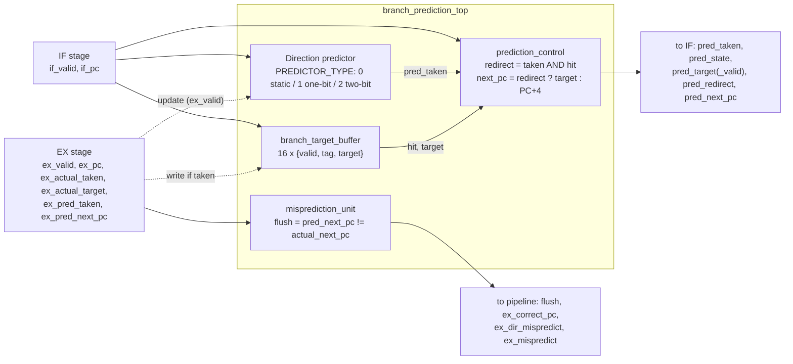
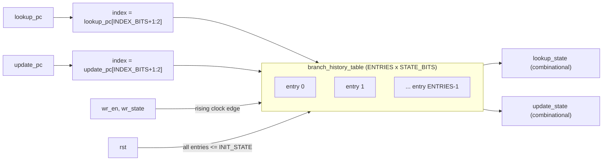
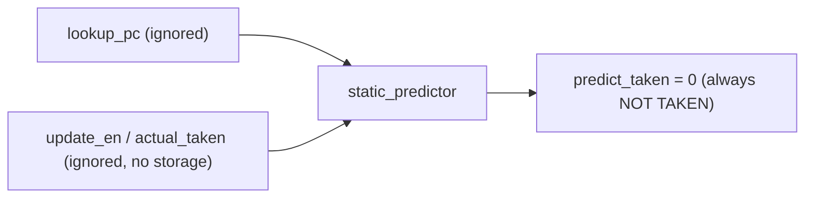
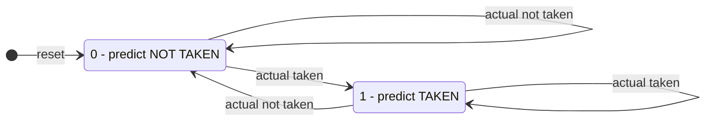
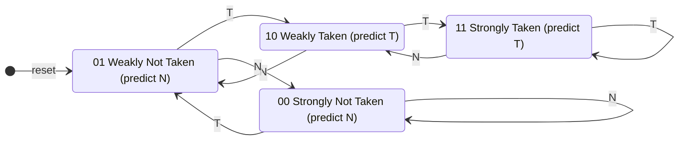
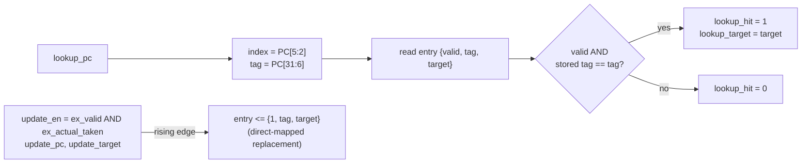
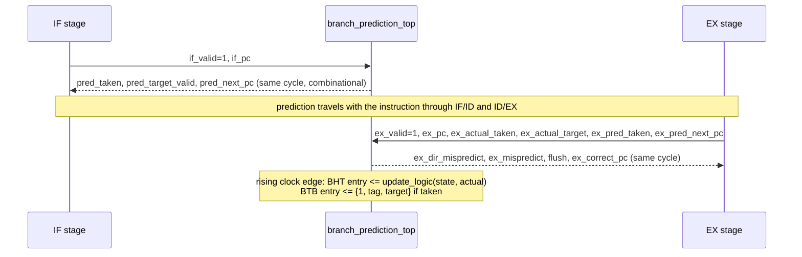
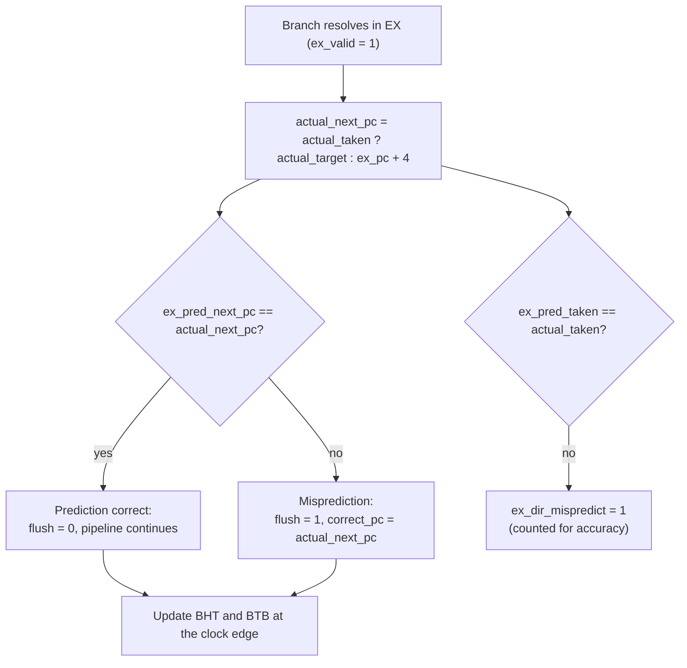
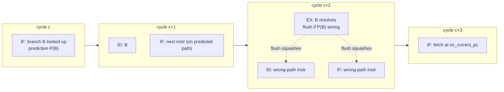
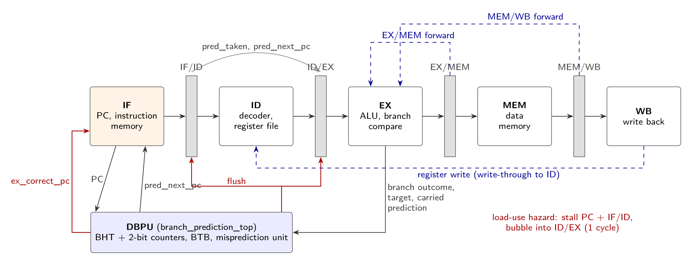

# DBPU Architecture

This document describes the design that is **actually implemented** in `rtl/`. Every diagram
below corresponds to a Verilog module; module and signal names are the real ones.

The DBPU is a **standalone branch prediction unit with a pipeline-style interface**. It is not a
processor. A hypothetical 5-stage pipeline (IF, ID, EX, MEM, WB) would connect its fetch stage to
the `if_*` / `pred_*` ports and its branch-resolution logic (EX) to the `ex_*` / `flush` ports.

Rendered (TikZ) versions of the key diagrams: `docs/diagrams/dbpu_architecture.png`,
`docs/diagrams/two_bit_fsm.png`, `docs/diagrams/one_bit_fsm.png`.

---

## 1. Module hierarchy

| Module | File | Type | Responsibility |
|---|---|---|---|
| `branch_prediction_top` | `rtl/branch_prediction_top.v` | structural | Selects the predictor (`PREDICTOR_TYPE`), wires predictor, BTB, IF and EX logic |
| `static_predictor` | `rtl/static_predictor.v` | combinational | Baseline: always predicts not taken |
| `one_bit_predictor` | `rtl/one_bit_predictor.v` | structural | 1-bit BHT + update logic |
| `two_bit_predictor` | `rtl/two_bit_predictor.v` | structural | 2-bit saturating-counter BHT + update logic |
| `branch_history_table` | `rtl/branch_history_table.v` | sequential | Parameterized untagged table, 2 read ports, 1 write port |
| `update_logic` | `rtl/update_logic.v` | combinational | N-bit saturating counter next-state function |
| `branch_target_buffer` | `rtl/branch_target_buffer.v` | sequential | Direct-mapped tagged BTB (valid, tag, target) |
| `prediction_control` | `rtl/prediction_control.v` | combinational | IF stage: chooses `pred_next_pc` |
| `misprediction_unit` | `rtl/misprediction_unit.v` | combinational | EX stage: detects misprediction, raises `flush`, gives `correct_pc` |

Default parameters: `PC_WIDTH = 32`, `BHT_ENTRIES = 16`, `BTB_ENTRIES = 16`, `PREDICTOR_TYPE = 2`.
All state is reset synchronously with the active-high `rst`.

## 2. Overall architecture (Diagram 1)

### Top-level interface

| Signal | Dir | Width | Stage | Meaning |
|---|---|---|---|---|
| `clk`, `rst` | in | 1 | - | Clock; synchronous active-high reset |
| `if_valid` | in | 1 | IF | A branch lookup is requested this cycle |
| `if_pc` | in | 32 | IF | Address of the instruction being fetched |
| `pred_valid` | out | 1 | IF | Prediction outputs are meaningful (= `if_valid`) |
| `pred_taken` | out | 1 | IF | Direction prediction from the selected predictor |
| `pred_state` | out | 2 | IF | Predictor state read for this PC (debug / waveforms) |
| `pred_target_valid` | out | 1 | IF | BTB hit |
| `pred_target` | out | 32 | IF | Target stored in the BTB |
| `pred_redirect` | out | 1 | IF | Fetch will jump to `pred_target` |
| `pred_next_pc` | out | 32 | IF | Next fetch address chosen by the predictor |
| `ex_valid` | in | 1 | EX | A conditional branch resolves this cycle (update enable) |
| `ex_pc` | in | 32 | EX | Address of the resolving branch |
| `ex_actual_taken` | in | 1 | EX | Actual outcome (BEQ/BNE condition) |
| `ex_actual_target` | in | 32 | EX | Actual branch target |
| `ex_pred_taken` | in | 1 | EX | The prediction made in IF, carried down the pipeline |
| `ex_pred_next_pc` | in | 32 | EX | The predicted next PC, carried down the pipeline |
| `ex_dir_mispredict` | out | 1 | EX | Direction was predicted wrongly |
| `ex_mispredict` | out | 1 | EX | Next PC was predicted wrongly |
| `flush` | out | 1 | EX | Squash the younger (wrong-path) instructions in IF/ID |
| `ex_correct_pc` | out | 32 | EX | Address at which fetch must restart |

## 3. Branch History Table (Diagram 2)

* **Index calculation:** `INDEX_BITS = $clog2(ENTRIES)`. Bits `[1:0]` are skipped because
  instructions are 4-byte aligned. For 16 entries, `index = PC[5:2]`.
* **Entry organization:** an array `table_mem[0:ENTRIES-1]` of `STATE_BITS`-wide registers
  (1 bit for the 1-bit predictor, 2 bits for the 2-bit predictor). No tags, no valid bits.
* **Initialization:** synchronous reset writes `INIT_STATE` into every entry
  (1-bit: `0` = not taken; 2-bit: `01` = weakly not taken).
* **Read behaviour:** two asynchronous read ports. The lookup port serves IF; the update port
  lets EX read the current state of the resolving branch (read-modify-write).
* **Write behaviour:** one synchronous write port, written on the rising edge when `wr_en = 1`.
  A lookup of the entry being written in the same cycle returns the **old** value.
* **Aliasing:** the table is untagged, so PCs that differ only above bit `INDEX_BITS+1` share an
  entry. Example (16 entries): `0x100` and `0x140` both map to index 0. This is demonstrated in
  `tb_one_bit_predictor`, `tb_two_bit_predictor`, `tb_branch_history_table` and by the
  `aliasing_trace` workload.

## 4. Static predictor (Diagram 3)

The baseline needs no storage: fetch always continues at PC + 4.

## 5. 1-bit predictor (Diagram 4)

Each entry remembers only the last outcome. For a loop branch with pattern `T T T T T N`
repeated, the 1-bit predictor mispredicts **twice per loop execution**: at the loop exit (it
predicts T, outcome N, so the bit becomes 0) and again on the first iteration of the next
execution (it predicts N, outcome T). This is visible in the waveform
`docs/waveforms/wave_predictor_comparison.png` and measured in Test 4.

## 6. 2-bit saturating counter (Diagram 5)

* Prediction = MSB of the counter (`10`, `11` predict taken).
* `update_logic` adds 1 on taken and subtracts 1 on not taken, **saturating** at `11` and `00`
  (it never wraps from `11` to `00`). Verified exhaustively in `tb_two_bit_predictor`.
* **Why it is more robust than 1-bit:** after a long run of taken outcomes the counter is `11`.
  One anomalous not-taken outcome (the loop exit) only moves it to `10`, which still predicts
  taken, so the first iteration of the next loop execution is predicted correctly. Two
  consecutive opposite outcomes are needed to change the prediction (hysteresis).
* Reset state `01` predicts not taken (like the baseline) but needs only one taken outcome to
  start predicting taken.

## 7. Branch Target Buffer (Diagram 6)

The BTB is **tagged**, so (unlike the BHT) it never returns another branch's target. Only taken
branches are written, because a not-taken branch needs no target. This also means a
never-taken branch that aliases in the BHT cannot cause a redirect (see the aliasing results).

## 8. Prediction lookup and update flow (Diagram 7)

## 9. Branch resolution and misprediction handling (Diagram 8)

Two kinds of error are reported:

| Case | `ex_dir_mispredict` | `flush` |
|---|---|---|
| Predicted N, actually N | 0 | 0 |
| Predicted T (BTB hit, right target), actually T | 0 | 0 |
| Predicted N, actually T | 1 | 1 |
| Predicted T, actually N | 1 | 1 |
| Predicted T but BTB miss (fetch went to PC+4), actually T | 0 | 1 |
| Predicted T with a stale BTB target, actually T | 0 | 1 |

## 10. Pipeline flush interface (Diagram 9)

Because the branch is resolved in EX, a misprediction squashes two younger instructions
(IF and ID), so the **misprediction penalty is 2 cycles**. `tb_branch_prediction_top` models
exactly this: on `flush` it discards the two in-flight lookups and restarts fetch, and it checks
that `cycles = branches + 2 + 2 x flushes` (a flush on the very last branch needs no refetch).
The rendered waveform `docs/waveforms/wave_pipeline_flush.png` shows this sequence.

## 11. Design decisions (and why)

| Decision | Reason |
|---|---|
| One `update_logic` module for both predictors | A 1-bit predictor is exactly a 1-bit saturating counter, so one parameterized module gives both behaviours and is verified once |
| Two read ports in the BHT | IF lookup and EX read-modify-write happen in the same cycle in a pipeline |
| Untagged BHT, tagged BTB | Textbook organization: direction tables are cheap and tolerate aliasing; a wrong target is more harmful |
| BTB written only on taken branches | Not-taken branches need no target; saves BTB capacity |
| 2-bit reset state `01` | Predicts not taken like the baseline but learns a taken branch after one outcome |
| Predictor chosen by parameter, not a run-time input | Real hardware implements one predictor; parameterization lets synthesis report each one separately |
| Synchronous reset, flip-flop storage | Simple, portable and easy to verify; tables are small (16 entries) |
| `flush` based on next-PC comparison | Catches direction errors and also BTB miss / wrong-target cases |

## 12. Processor integration (Phase II)

`rtl/rv32_pipeline_core.v` places `branch_prediction_top` in the fetch stage of a classic
five-stage RV32I pipeline (subset: ADD, SUB, AND, OR, XOR, SLT, SLL, SRL and their immediate forms,
LW, SW, BEQ, BNE, ECALL as halt).

| Aspect | Implementation |
|---|---|
| Fetch | `if_pc = PC` every cycle; next PC = `pred_next_pc` (or held on a stall, or `ex_correct_pc` on a flush) |
| Prediction carried | `pred_taken`, `pred_next_pc` stored in IF/ID and ID/EX, returned to the DBPU as `ex_pred_*` |
| Branch resolution | EX: `ex_valid = branch in EX`, outcome from the forwarded operands, target = PC + imm |
| Misprediction | DBPU `flush` turns IF/ID and ID/EX into bubbles; fetch restarts at `ex_correct_pc` (2 cycles) |
| Forwarding | EX/MEM -> EX and MEM/WB -> EX for ALU operands, store data and branch operands |
| WB -> ID | register file write-through |
| Load-use hazard | 1-cycle stall: PC and IF/ID held, bubble into ID/EX |
| Memories | 1 KiB instruction memory (programming port) and 1 KiB data memory |
| Halt | ECALL reaching WB sets `halted`; all state freezes |
| Counters | cycles, instret, branches, flushes, direction mispredictions, stalls |

Cycle accounting: every flush inserts 2 bubbles, every stall 1, and the pipeline needs 4 cycles
to fill, so `cycles = instret + 4 + 2 x flushes + stalls`; the testbench checks this for every run.

Programs are written in assembly (`programs/*.s`), assembled by `scripts/rv32.py`, and executed by
the same file's instruction-set simulator to obtain the expected registers and memory.

## 13. Limitations

* The processor implements a subset of RV32I (no JAL/JALR, byte/halfword accesses or
  multiplication); programs are small kernels.
* Branch traces are synthetic (generated from small loop programs), not captured from a real CPU.
* Only conditional direct branches (BEQ/BNE) are modelled; no JAL/JALR, return-address stack or
  indirect-target prediction.
* One branch is looked up per cycle; no superscalar fetch.
* The BHT is local and untagged; no global history (gshare, two-level, tournament).
* Synthesis numbers are Yosys pre-place-and-route estimates; no Fmax and no FPGA hardware run.
