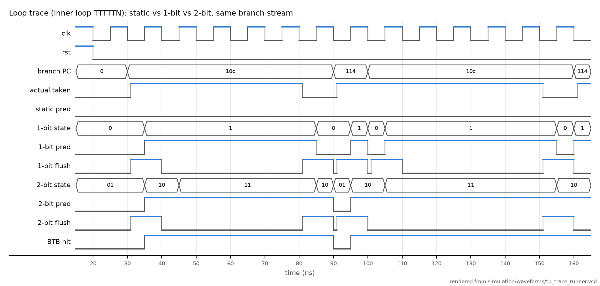
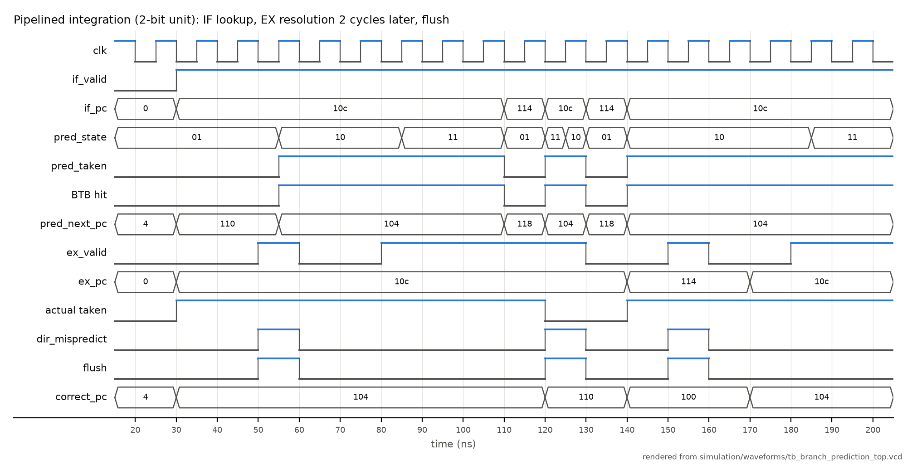
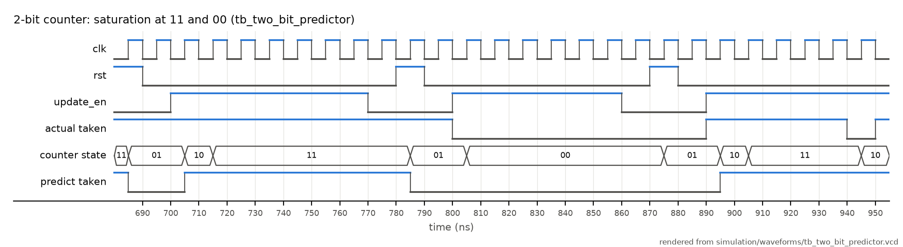
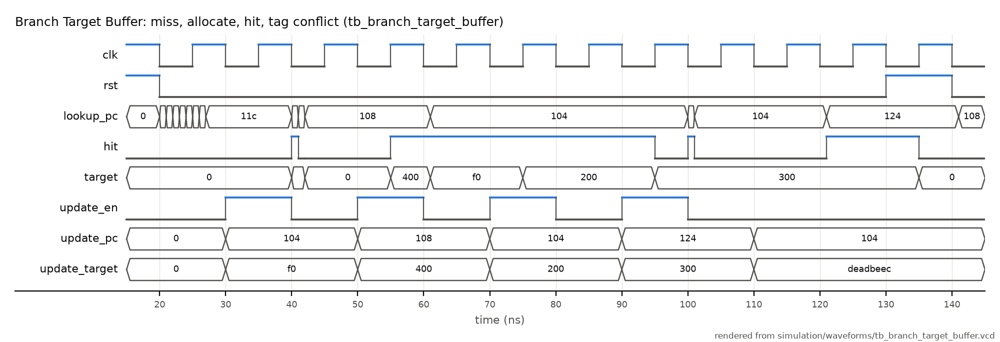

# DBPU Verification and Testing

Every result in this file was produced by running the commands shown, using Icarus Verilog 13.0
on macOS. Re-run them to reproduce. Run all commands from the repository root.

```bash
make test                   # all 7 self-checking testbenches
make results                # trace sims + BHT sweep + pipelined runs + analysis (needs matplotlib)
bash scripts/mutation_test.sh   # checks that the testbenches catch injected bugs
```

## 1. Verification strategy

1. **Unit testbenches**: one per module group. They drive directed stimulus, compare against
   expected values written into the testbench, and print `ok` / `FAIL` per check and one
   `TEST_RESULT: PASS|FAIL` line.
2. **Integration testbench** (`tb_branch_prediction_top`): runs all three predictor
   configurations with pipeline timing (IF lookup, EX resolution 2 cycles later, squash on flush).
   Every cycle it compares **all** DUT outputs with an independent behavioural reference model
   written in the testbench.
3. **Trace runner + Python reference model**: `tb_trace_runner` logs every prediction the RTL
   makes on each trace. `analysis/performance_analysis.py` re-computes every prediction, state
   and flush with an independent Python model and fails if a single field differs.
4. **Mutation testing** (`scripts/mutation_test.sh`): deliberately breaks the RTL (in a copy) and
   confirms that the testbenches report FAIL. This shows the tests can actually detect bugs.

## 2. Results summary (actual run)

`make test` output:

```
TESTBENCH                    RESULT DETAILS
---------                    ------ -------
tb_static_predictor          PASS   83/83 checks passed
tb_one_bit_predictor         PASS   49/49 checks passed
tb_two_bit_predictor         PASS   70/70 checks passed
tb_branch_history_table      PASS   33/33 checks passed
tb_branch_target_buffer      PASS   22/22 checks passed
tb_misprediction             PASS   12/12 checks passed
tb_branch_prediction_top     PASS   3013/3013 checks passed

Summary: 7 passed, 0 failed
```

Integration testbench on each trace (`make pipeline`): PASS on all six traces
(4198, 4993, 5735, 4136, 9348 and 4098 checks).

Python cross-check (`make analysis`): **0 mismatches** over 6 traces (570 branches) and
12 BHT-size sweep runs.

Mutation testing: **7 of 7** injected bugs detected (details in section 5).

## 3. Test-by-test description

The test numbers follow the project plan.

| # | Test | Testbench | Inputs | Expected | Result |
|---|---|---|---|---|---|
| 1 | Static predictor | `tb_static_predictor` | Reset, loop pattern TTTTTN x3, 64 random PCs/outcomes | `predict_taken = 0` every time | PASS (83 checks) |
| 2 | 1-bit predictor | `tb_one_bit_predictor` | Reset; PC 0x100: T,T,T,N,N,N,T | Reset NT; NT->T after one T; stays T; flips to N after one N; stays N | PASS (49 checks) |
| 3 | 2-bit predictor | `tb_two_bit_predictor` | All 4 start states x {T, N}; 5 extra T at 11; 5 extra N at 00; alternating pattern from reset 00 | The 8 transitions of the table; 11 stays 11; 00 stays 00 (no wrap); reset 00 gives 6/12 mispredictions on alternating branches | PASS (70 checks) |
| 4 | Loop behaviour | `tb_one_bit_predictor`, `tb_two_bit_predictor`, `loop_trace` | TTTTTN executed 3 times | 1-bit: 6 mispredictions (2 per execution). 2-bit: 4 (2 in the first execution, then 1 each) | PASS |
| 5 | Alternating | `tb_two_bit_predictor`, `alternating_trace` | T,N,T,N... | 2-bit from reset 01 oscillates 01<->10 and misses every branch (12/12) | PASS |
| 6 | Multiple addresses / aliasing | `tb_one_bit_predictor`, `tb_two_bit_predictor`, `tb_branch_history_table`, `aliasing_trace` | PC 0x100 vs 0x104 (different entries); 0x100 vs 0x140 (same entry) | Separate entries are independent; aliased PCs corrupt each other | PASS |
| 7 | Mostly taken / not taken | `mostly_taken`, `mostly_not_taken` traces | 90 % T; 10 % T | Accuracy table (section 4) | Measured |
| 8 | Mixed workload | `mixed_trace` | 5 branches with different behaviour | Accuracy table (section 4) | Measured |
| 9 | Misprediction detection | `tb_misprediction` | 5 prediction-control cases, 7 resolution cases | Correct `flush`, `dir_mispredict`, `correct_pc`, `pred_next_pc` | PASS (12 checks) |
| 10 | Reset | all unit testbenches + top | Mid-run reset after training | Every BHT entry back to INIT_STATE; BTB valid bits cleared | PASS |
| 11 | BTB | `tb_branch_target_buffer` | Miss after reset; allocate; tag conflict; replace; re-target; `update_en = 0`; highest PC `0xFFFFFFFC`; reset | Hit/miss and target exactly as expected | PASS (22 checks) |
| 12 | Top-level integration | `tb_branch_prediction_top` | 42 directed branches + all 6 traces, 3 predictors, pipelined timing | All outputs equal the reference model every cycle; cycle count equals the model | PASS |

### Test 2 details: 1-bit sequence (from the log)

```
ok   [initial prediction NT, actual T] pc=00000100 actual=1 pred=0
ok   [learned T after first taken] pc=00000100 actual=1 pred=1
ok   [repeated taken] pc=00000100 actual=1 pred=1
ok   [actual N while predicting T (mispredict)] pc=00000100 actual=0 pred=1
ok   [switched to NT after one N] pc=00000100 actual=0 pred=0
ok   [repeated not taken] pc=00000100 actual=0 pred=0
ok   [single T after N run (mispredict)] pc=00000100 actual=1 pred=0
ok   [loop TTTTTN x3] mispredicts=6 (2 per loop execution)
```

### Test 3 details: complete 2-bit transition table (from the log)

```
ok   [update_logic 2b] 00 + N -> 00      ok   [update_logic 2b] 00 + T -> 01
ok   [update_logic 2b] 01 + N -> 00      ok   [update_logic 2b] 01 + T -> 10
ok   [update_logic 2b] 10 + N -> 01      ok   [update_logic 2b] 10 + T -> 11
ok   [update_logic 2b] 11 + N -> 10      ok   [update_logic 2b] 11 + T -> 11
ok   [saturate high: 11 + T x5 stays 11] state=11 pred=1
ok   [saturate low: 00 + N x5 stays 00] state=00 pred=0
ok   [loop TTTTTN x3] mispredicts=4 (1 per execution after warm-up)
ok   [alternating x12] mispredicts=12 (worst case: oscillates WNT<->WT)
ok   [alternating x12, reset 00] mispredicts=6 (right every second branch)
```
The same 8 transitions are also checked through the real BHT (start state, apply outcome,
read back), not only on the stand-alone `update_logic`.

### Test 9 details: misprediction cases (from the log)

```
ok   [pred NT, actual NT: correct] dir_mp=0 flush=0 correct_pc=00000104
ok   [pred T,  actual T : correct] dir_mp=0 flush=0 correct_pc=000000c0
ok   [pred NT, actual T : flush -> target] dir_mp=1 flush=1 correct_pc=000000c0
ok   [pred T,  actual NT: flush -> PC+4] dir_mp=1 flush=1 correct_pc=00000104
ok   [pred T but BTB miss: flush (target)] dir_mp=0 flush=1 correct_pc=000000c0
ok   [pred T, wrong BTB target: flush] dir_mp=0 flush=1 correct_pc=000000c0
ok   [ex_valid=0: no flags] dir_mp=0 flush=0 correct_pc=000000c0
```

## 4. Trace-driven evaluation (Tests 4, 5, 7, 8)

The identical trace is fed to all three predictors (three instances of
`branch_prediction_top` in `tb_trace_runner`). Full tables:
`analysis/results/summary.md` (auto-generated). Direction accuracy, BHT = 16 entries:

| Workload | Branches | Always NT | 1-bit | 2-bit |
|---|---:|---:|---:|---:|
| Loop-heavy | 70 | 15.71 % | 68.57 % | 81.43 % |
| Alternating | 60 | 50.00 % | 0.00 % | 0.00 % |
| Mostly taken | 100 | 10.00 % | 83.00 % | 87.00 % |
| Mostly not taken | 100 | 90.00 % | 82.00 % | 89.00 % |
| Mixed | 160 | 39.38 % | 56.25 % | 74.38 % |
| Aliasing (16-entry BHT) | 80 | 50.00 % | 0.00 % | 0.00 % |

Hand check of the loop trace (10 executions of the inner loop TTTTTN plus the outer branch):
1-bit = 2 x 10 (inner) + 2 (outer) = 22 mispredictions. 2-bit = 2 + 9 x 1 (inner) + 2 (outer)
= 13. The RTL produced exactly 22 and 13.

## 5. Mutation testing (testing the tests)

`bash scripts/mutation_test.sh` copies `rtl/`, injects one bug, and re-runs the relevant
testbenches. The real RTL is never modified.

| Injected bug | Detected by |
|---|---|
| 2-bit counter wraps 11 -> 00 (no saturation) | `tb_two_bit_predictor` (64/70), `tb_branch_prediction_top` |
| BTB ignores the tag | `tb_branch_target_buffer` (18/22), `tb_branch_prediction_top` |
| `flush` raised only on direction error | `tb_misprediction` (10/12), `tb_branch_prediction_top` |
| BHT index ignores word alignment | `tb_branch_history_table` (25/33) |
| 2-bit prediction taken from LSB | `tb_two_bit_predictor` |
| BHT reset value ignored | `tb_branch_history_table`, `tb_two_bit_predictor` |
| Redirect without BTB hit | `tb_misprediction`, `tb_branch_prediction_top` |

Result: `RESULT: all mutants detected`.

## 6. Waveform evidence and how to read it

VCD files are written to `simulation/waveforms/` by every testbench (`make test`;
`make sim-traces` also dumps `tb_trace_runner.vcd` for the loop trace). They are not committed
to Git (they are regenerated in seconds).

* **Interactive:** `make wave TB=tb_two_bit_predictor` opens GTKWave with the saved signal list
  (`simulation/waveforms/*.gtkw`). GTKWave was **not installed** on the development machine;
  install it with `brew install --cask gtkwave` (macOS) or `sudo apt install gtkwave` (Linux).
  The VS Code extensions "WaveTrace" or "Surfer" can also open VCD files.
* **Static images:** `make waves` runs `scripts/vcd_to_png.py`, which parses the real VCD files
  and draws the figures in `docs/waveforms/`. These are renderings of simulation data, not
  GTKWave screenshots; each image names the VCD it came from.

### Figure: `wave_predictor_comparison.png` (loop trace, `tb_trace_runner`)



* One branch per clock period (10 ns). For each branch the testbench sets `branch PC`
  just after the falling edge, the predictors answer combinationally, and the state is updated
  at the next **rising** edge.
* `static pred` is always 0.
* At 30-40 ns the first `0x10c` is seen: all predictors predict NT, actual is T, so both
  `flush` signals go high (cold miss). The 2-bit state then goes `01 -> 10 -> 11`.
* At 80-90 ns the loop exits (actual = 0): both dynamic predictors mispredict (`flush` = 1).
  The 1-bit state drops to 0, the 2-bit state only to `10`.
* At 100-110 ns the loop starts again: the **1-bit** predictor (state 0) mispredicts again,
  the **2-bit** predictor (state `10`) predicts T correctly. This is the key difference.

### Figure: `wave_pipeline_flush.png` (2-bit unit, `tb_branch_prediction_top`)



* `if_pc` is looked up in IF; the same branch appears on `ex_pc` with `ex_valid = 1` two cycles
  later.
* At 50 ns branch `0x10c` resolves: predicted NT (`pred_state` was `01`), actual T, so
  `dir_mispredict` and `flush` are high and `correct_pc = 0x104` (the target).
* After a flush, `ex_valid` is low for two cycles (60-80 ns): these are the squashed bubbles.
* Notice the predictor state stays `01` for three lookups at 30-50 ns: the first update has not
  happened yet (realistic delayed update).

### Figure: `wave_two_bit_transitions.png` (`tb_two_bit_predictor`)



* After reset the counter is `01`; two taken updates give `10`, `11`; five more taken updates
  keep it at `11` (saturation, no wrap).
* After the next reset one not-taken update gives `00`; five more keep it at `00`.

### Figure: `wave_btb.png` (`tb_branch_target_buffer`)



* `update_en` pulses write {PC, target}. After the write to `0x104`, a lookup of `0x104` hits
  with target `0xf0`; a lookup of `0x124` (same index, different tag) misses until it replaces
  the entry. Lookups are combinational and are sampled 1 ns after `lookup_pc` changes, so they
  appear as short segments.

## 7. Known limitations of the verification

* Directed and trace-based testing only; no formal verification or constrained-random
  coverage collection (no SystemVerilog/UVM in the flow).
* Traces are synthetic; real benchmark traces (e.g. from a RISC-V simulator) are future work.
* The integration testbench models the pipeline in the testbench; the RTL has not been connected
  to a real processor.
